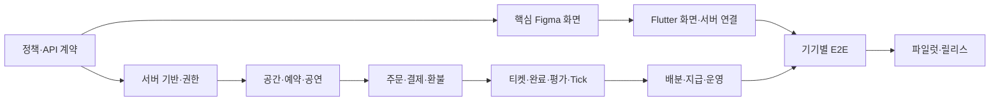

# CrocTick 나머지 개발 실행 계획

기준일 2026-11-11. 현재 버전 5ba2f06의 Flutter 로컬 MVP를 출발점으로 한다. 일정은 작업 의존관계 기준이며, 인력·PG 계약·디자인 전달일이 확정되지 않아 날짜 약속이나 고정 견적은 아니다.

## 1. 이미 있는 것과 미완성인 것

| 영역 | 현재 | 남은 개발 |
|---|---|---|
| 공통 앱 | Flutter Android/iOS 실행, 기본 탭·검색·등록·상세 | Figma 세 화면 시각적 일치, 추가 화면, 접근성·폰/태블릿 회귀 |
| 저장 | SharedPreferences의 단일 JSON, 로컬 사진 | 서버 repository, 계정별 동기화, 이미지 업로드·썸네일, 캐시 |
| 권한 | mine 플래그·로컬 시연 운영 패널 | 인증·역할·리소스 소유권·운영자 권한 |
| 공간 | 기본 정보·장비·사진·수용인원 | 운영시간/휴무, 검토·보완, 멤버 관리, 주소 검증 |
| 공연 | 폼·포스터·시간 구간 충돌 검사 | draft·재승인·승인 이력, 마감 입력, 준비/철수 시간, 서버 동시성 |
| 예약 | 한 기기 내 구간 비교 | DB exclusion 제약, 승인 보유·만료·취소·동시 승인 처리 |
| 펀딩 | 버튼으로 금액 증가 | 실제 주문·재고 보유·PG 승인·원장·마감 작업 |
| 티켓 | 로컬 참여 기록 | 결제 기반 개별 티켓, QR/검표, 취소·환불 상태 |
| 완료/평가 | 로컬 점수 선택·정산 버튼 | 실제 완료 확인, 적격 평가자, 평가 마감·분쟁 |
| Tick | 등급·내역, 완료·평가 1회 적립 시연 | 운영 점수표·정책 버전, 서버 원장, 중복·자가평가 차단 |
| 수익 | 50/40/10 계산 결과 | 배분 기준액 확정, 환불 반영, 수취인 검증, 지급·대조 |
| 알림 | 벨이 Tick 화면에 연결 | 알림 목록·푸시 토큰·딥링크·읽음·재시도 |
| 운영/출시 | 디버그 설치·기본 테스트 | 운영 웹, 오류 추적·백업·CI·서명·스토어 심사 준비 |

## 2. 개발 방식

### Flutter
- 단일 앱 유지. 새 기능은 기존 SwiftUI/React에 중복 구현하지 않는다.
- main.dart의 큰 화면 파일을 auth/venues/shows/orders/tickets/tick/settlements/notifications 기능별 폴더로 분리.
- UI → 상태 관리 → repository → API client 순으로 의존. DemoRepository와 ApiRepository를 교체할 수 있게 한다.
- Map 기반 데이터를 Dart의 명시적인 모델·enum·직렬화로 교체. 서버 상태와 로컬 로딩/오류 상태를 구분.
- 결제·정산에서 optimistic update로 성공을 표시하지 않는다. 일반 프로필 수정은 저장 실패를 복구 가능하게 한다.
- 사진 파일은 업로드 큐·재시도·대표 이미지 선택을 지원. 기기 경로를 서버 URL로 저장하지 않는다.
- JSON 읽기 실패 시 사용자 자료를 조용히 시연 데이터로 덮어쓰는 현재 동작을 제거. 복구 안내와 백업/진단을 제공.

### 서버
- TypeScript/NestJS 모듈형 API + PostgreSQL + 객체 저장소 + Worker.
- OpenAPI 계약을 먼저 작성하고 Flutter client/서버 DTO를 그 계약에 맞춘다.
- DB 마이그레이션으로 schema와 제약을 버전 관리. 서비스 테스트는 실제 PostgreSQL을 사용해 동시성을 검증.
- PG·푸시·인증은 adapter 뒤에 둬 mock/test/운영 구현을 바꿀 수 있게 한다.
- 업무 트랜잭션에 outbox를 함께 저장. 결제·환불·지급 외부 호출은 재시도 가능한 상태 머신으로 처리.

## 3. 단계별 작업과 완료 기준

### 단계 0 — 정책·UI·API 계약 확정
작업: 디자인 ID별 누락 상태 확인, 인증/PG 후보 선정, 도메인 상태·OpenAPI·DB ERD 확정. 로컬 시연과 운영 상태의 차이 문서화.
입력: DESIGN_REQUIREMENTS.md 1차 프레임, 아래 미확정 정책.
완료 기준: 어떤 사용자가 어떤 버튼을 누르고 어떤 상태로 바뀌는지 일관되며, 환불·가격·Tick 용어가 서로 모순되지 않는다.

### 단계 1 — 서버 기반·인증·미디어
작업: 개발/staging 환경, DB 마이그레이션, CI, 로그인/프로필/역할, media 업로드, 사용자별 권한, API 오류 규약.
병렬: Flutter repository 분리·로그인/업로드 화면 구현.
완료 기준: 다른 기기에서 같은 계정 데이터를 조회하고, 타인의 비공개 자료 수정은 거절. 새 설치에도 사진 유지. 업로드 실패 재시도 동작.

### 단계 2 — 공간·공연·예약
작업: 공간 CRUD·검토·운영시간·휴무, 공연 draft·포스터·정원·Tick 한도·준비/철수·마감, 승인/보완/거절/철회.
완료 기준: 동시에 겹친 예약 두 건을 승인해도 하나만 성공. 인접 시간 허용. 휴무와 겹친 요청 거절. 예약 변경은 재승인. 취소된 예약 시간은 재사용 가능.
이 시점부터 여러 실제 계정이 같은 공간·공연을 보고 협업하는 비결제 파일럿 가능.

### 단계 3 — 주문·결제·자동 마감·환불
작업: 서버 금액 계산, 주문별 재고 보유, PG 테스트 승인/조회/취소, webhook, 마감 작업, 환불 작업, 주문/결제 조회 UI.
완료 기준: 결제 버튼 반복·동일 webhook 재전송에도 티켓/금액 1회 반영. PG 성공 후 DB 반영 실패를 재조정. 재고보다 많이 팔리지 않음. 미달 마감은 앱이 꺼져 있어도 취소·환불 작업 생성. 실패 환불을 완료로 표시하지 않음.
외부 의존: PG 테스트/운영 키와 계약, webhook 도메인.

### 단계 4 — 티켓·완료·평가·Tick
작업: 개별 티켓·권한·QR·검표, 공연 완료 확인, 평가 적격성/기한, 점수 정책 버전·원장.
완료 기준: 타인 티켓 조회/취소 티켓 입장/QR 재사용 차단. 본인 평가·중복 평가 차단. 등록/참여만으로 점수가 오르지 않음. 재시도에도 동일 공연 Tick 1회 적립. 조정 이력 보존.
P22 스캐너 디자인 전에는 권한 있는 운영자의 티켓번호 수동 검표로 제한된 파일럿 가능.

### 단계 5 — 수익 배분·지급·운영 웹
작업: 배분 기준액·50/40/10 snapshot, 환불·분쟁 보류, 수취인 onboarding, 지급 요청·결과 대조, 관리자 작업함·감사 이력.
완료 기준: 원 단위 합계 일치. 환불액 제외. 실제 송금 실패를 지급 완료로 표시하지 않음. 중복 지급 차단. 관리자도 사유 없이 금액·Tick을 덮어쓸 수 없음.
외부 의존: 지급대행 계약/수취인 검증. 미확보 시 원장·지급예정 UI와 수동 대조만 운영.

### 단계 6 — 디자인 마감·운영 안정화·배포
작업: Figma 매칭, 작은 폰/큰 글꼴/가로/태블릿/키보드 검증, Android 뒤로가기·iOS 복귀·사진 권한·결제 딥링크, 알림, 약관·계정 삭제, 오류 추적·복원 훈련, 릴리스 서명.
완료 기준: Galaxy Tab 실기기 + iPhone/iPad 실기기 주요 플로우 검증. staging 전체 E2E 통과. 로그에 결제키·계좌 등 민감자료 없음. 장애 작업 재실행과 DB 복구 절차 검증.
실제 iOS 기기가 연결되지 않으면 빌드/시뮬레이터 검증과 실기기 검증을 분리해 보고한다.

## 4. 병렬 진행 순서

디자인은 모든 화면이 끝날 때까지 기다릴 필요가 없다. 1차 핵심 프레임을 받는 동안 인증/DB/계약 테스트를 진행한다. PG 계약 대기 중에는 provider mock으로 성공/실패/중복/응답 유실 시나리오를 구현한다.

## 5. 결정이 필요한 정책

| 항목 | 현재 확정 또는 제안 | 왜 필요한가 |
|---|---|---|
| 수익 배분 | 확정: 공간50/공연자40/플랫폼10 | 정산 원장 |
| 배분 기준액 | 미확정: 총매출/환불 차감 후/PG 수수료·세금 부담 | 실제 수취 금액 |
| Tick 적립 시점 | 확정: 공연 완료·평가 후 | 등록 점수 남용 제거 |
| Tick 점수·주체 | 미확정: 제공자/관객 가중치·기한·무평가 처리. 현재 1+별점은 임시 | 공정한 서버 정산 |
| 신규 Tick | 시연은18, 실사용 초기값 미확정 | 시작 등급 |
| 티켓 가격 한도 | 상한으로 구현 중; 이미지의 '최저 티켓가' 의미 확인 필요 | 실제 가격 검증 |
| 고정 대관료 | 기존 앱 필드 있음. 사업계획서의 선지출 없는 배분 방식과 정리 필요 | 이중 청구 방지 |
| 예약 독점·만료 | 제안: 승인된 보유만 충돌 차단, 기한 지나면 해제 | 무기한 공간 점유 방지 |
| 펀딩 달성 시점 | 즉시 확정/마감 확정, 달성 후 추가 판매 여부 미확정 | 주문·취소·입장 상태 |
| 취소/변경/노쇼 | 기한·책임·환불·분쟁 처리 미확정 | 실제 고객 보호와 금전 처리 |
| 완료 증빙 | 양측 확인 또는 운영자 확인, 검표 이력 활용 제안 | 자가 정산 방지 |
| 결제·지급 사업자 | 계약/계정 확정 필요 | 실제 돈의 입출금 |

위 항목은 UI·서버 모두 설정 가능한 정책으로 설계한다. 임시 가정을 확정된 운영 규칙으로 사용자에게 노출하지 않는다.

## 6. 즉시 착수할 다음 작업

1. OpenAPI YAML과 schema migration 초안 작성.
2. Flutter Map 모델/Store를 typed model·repository로 분리.
3. 로컬 PostgreSQL/API·PG mock 테스트 환경 구성.
4. 인증 제공자·서버 계정 확보 후 staging 배포.
5. 공간·예약 동시 승인부터 실제 서버 플로우 연결.

이 문서 작성은 서버 생성·유료 자원 계약·계정 연결을 실행하는 작업과 구별한다. 현재는 설계와 요구사항만 작성했다.
