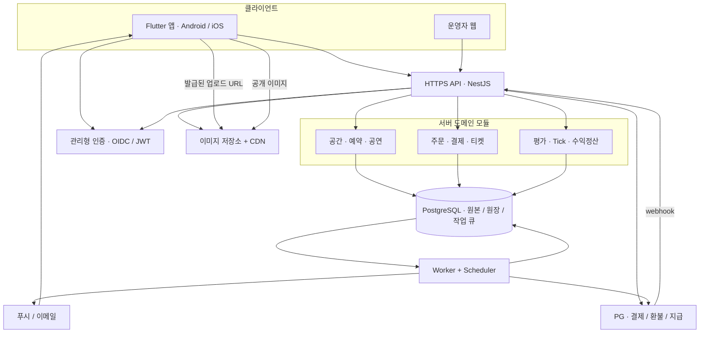
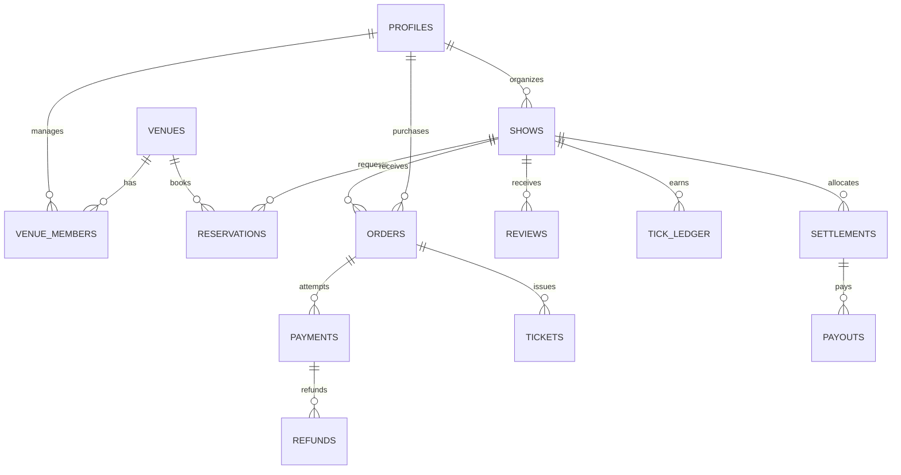
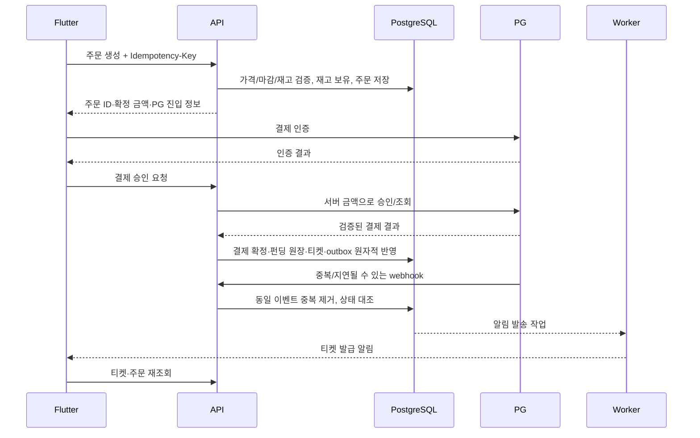
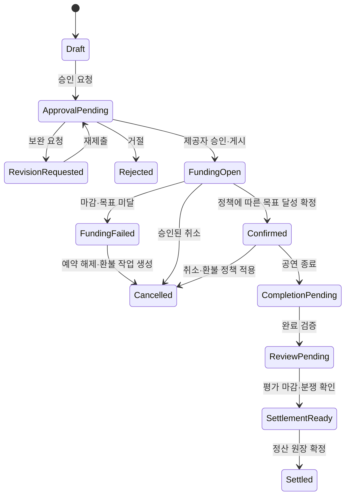

# CrocTick 시스템 아키텍처

설계 기준일: 2026-11-11. 이 문서는 앞으로 구현할 운영 시스템의 설계이며 현재 서버가 구축되어 있다는 뜻은 아니다.

## 1. 현재와 목표

현재 Flutter 앱은 한 기기의 JSON 저장소를 사용한다. 로그인, 다른 사용자와의 데이터 공유, 실제 결제, 자동 환불, 지급, 소유자 권한은 연결되지 않았다. 로컬 시연 승인·평가 버튼은 운영 앱에 그대로 노출할 수 없다.

목표는 Flutter 단일 앱(Android/iOS), 운영 웹, 공통 API와 데이터베이스를 두는 구조다. 계정 하나가 관객·뮤지션·공간 제공자 역할을 함께 가질 수 있다. 권한은 화면 선택값이 아니라 서버의 소유권·역할·공연 참여 기록으로 판정한다.

## 2. 권장 구성

초기에는 TypeScript/NestJS 모듈형 API 서버 하나와 같은 코드베이스의 백그라운드 작업자를 사용한다. 도메인별로 모듈을 나누되 여러 마이크로서비스로 분리하지 않는다. Flutter는 Riverpod 등 상태 관리와 repository 인터페이스를 통해 API를 사용하며, 기존 Store의 JSON은 시연 전용 구현으로 남긴다.

| 구성 | 필요한 역할 | 초기 권장 형태 |
|---|---|---|
| API 서버 | 인증 확인, 공간/공연 CRUD, 승인, 주문, 평가, 정책 검증 | 컨테이너 1개부터 시작; 서비스 규모에 따라 복제 |
| Worker + Scheduler | 펀딩 마감, 보유 만료, 환불·지급 재시도, 알림 | API와 같은 이미지의 별도 실행 프로세스 |
| PostgreSQL | 원본 데이터, 예약 구간, 주문·결제·Tick·수익 원장 | 관리형 DB, 자동 백업, 복구 테스트 |
| 객체 저장소 | 공간 사진·공연 포스터·증빙 | S3 호환 저장소 + CDN, 공개 이미지와 비공개 증빙 분리 |
| 인증 서비스 | 계정, 로그인, 토큰·비밀번호 복구 | 관리형 OIDC/JWT 서비스 권장; 제공자 확정 후 연결 |
| PG | 결제 승인·취소·조회, webhook, 필요 시 지급대행 | 국내 사업자 계약 후 테스트 키부터 연결 |
| 알림 | 앱 내 알림, Android/iOS 푸시 | FCM/APNs, 필요 시 거래성 이메일 |
| 운영 웹 | 검토, 분쟁, 결제 대조, 환불 실패, 지급 보류 | 작은 관리자 웹; API의 관리자 권한 사용 |
| 관측·CI | 오류/지연/작업 실패/배포 추적 | 구조화 로그, 오류 수집, CI 테스트 및 단계별 배포 |

개발/테스트 환경과 운영 환경은 DB·스토리지·결제 키를 분리한다. 초기 Redis는 필수가 아니다. 작업은 PostgreSQL outbox/jobs + 행 잠금으로 처리하고 작업량이 늘면 별도 메시지 큐를 붙인다. 검색도 초기에는 DB 검색으로 시작한다.

서버 호스팅은 장시간 작업과 HTTPS webhook을 받을 수 있는 관리형 컨테이너 환경이면 된다. 예산·리전·계정이 확정되기 전 특정 사업자나 고정 월 비용을 확정하지 않는다. API와 DB는 가급적 가까운 리전에 둔다. 워커가 주기적으로 확실히 실행되는 환경이 필요하다.

## 3. 전체 구조

그림의 Core는 API 내부 모듈이며 각각 별도 서버가 아니다. 푸시·실시간 갱신은 사용자 알림 수단이고 주문·티켓의 원본 상태는 API 조회 결과다.

## 4. 데이터 모델

모든 ID는 서버 생성 UUID, 모든 금액은 KRW 정수, 시간은 DB UTC timestamptz, 화면은 Asia/Seoul 등 공연 지역 시간대로 표시한다. 기간은 [시작, 종료)로 처리해 종료 직후 다음 예약을 허용한다.

| 테이블 | 핵심 필드·관계 |
|---|---|
| profiles / user_roles | 인증 subject, 이름, 계정 상태, 역할; 인증 자격증명은 인증 서비스 소유 |
| artist_profiles | 사용자, 소개·활동 정보, 검증 상태 |
| venues / venue_members | 공간 소유자·관리자, 주소, 정원, 장비, 운영 조건, 게시 상태 |
| venue_availability / blackout_periods | 운영 시간·예약 불가 구간 |
| media | owner, object key, 용도, MIME, 크기, 업로드/검사 상태 |
| shows / show_artists | 공연자, 공간, 프로그램, 포스터, 관람 조건, 가격, 목표, 판매수량, 마감 |
| reservations | 공간, 공연, 준비 포함 시작/철수 포함 종료, 요청·보유·확정·취소 상태, 보유 만료 |
| reservation_events | 승인/보완/반려/변경 요청, actor와 사유, 변경 전후 버전 |
| orders / order_items | 구매자, 공연, 수량, 서버 계산 단가·총액 snapshot, idempotency key |
| inventory_holds | 주문별 티켓 보유량, 만료, 사용/해제 상태 |
| payments / payment_events | 주문, PG 거래키, 승인액, 상태, provider event ID |
| refunds | 결제, 요청액, 이유, 처리/실패/완료, PG 요청 식별자 |
| tickets / check_ins | 티켓 단위 ID, 소유자, 공연, QR nonce, 사용·무효 상태 |
| show_completion_confirmations / reviews | 공연 완료 증빙/양측 확인, 평가자 역할, 별점·내용·유효성 |
| tick_policies / tick_ledger | 정책 버전, 대상 공연·사용자, 적립/조정 원장; 중복 정산 unique |
| settlement_policies / settlements / settlement_entries | 비율 snapshot, 배분 대상액, 지급 대상·금액, 보류/승인/완료 |
| payout_accounts / payouts | PG 수취인 token, 마스킹 정보, 지급 요청·실패·완료 |
| notifications / device_tokens | 사용자별 읽음과 발송 상태, 플랫폼별 토큰 |
| outbox / jobs | 업무 트랜잭션에 함께 기록한 이벤트, 시도 횟수, 다음 실행, 잠금 |
| audit_logs / reports | 관리자 작업, 민감 변경, 분쟁·신고와 처리 기록 |

## 5. 예약을 실제로 중복 방지하는 방법

- 신청만으로는 장기 독점하지 않는다. 여러 요청은 접수 가능하되 승인되는 유효 구간은 하나여야 한다.
- 승인 트랜잭션에서 소유권, 공연 상태, 운영 시간, 정원, 준비/철수 구간을 검증한다.
- reservations의 공간 ID + tstzrange에 PostgreSQL exclusion constraint를 둬 보유/확정 상태끼리 겹치지 않게 한다. 운영자 휴무 등록도 같은 충돌 경로로 처리한다.
- 앱에서만 검사하거나 단순 SELECT 후 INSERT하지 않는다. 동시 승인 두 건은 DB가 하나를 거절하고 API는 409 RESERVATION_CONFLICT를 반환한다.
- 승인 보유의 만료 시각은 설정값이다. 만료된 보유는 워커와 승인 트랜잭션에서 정리한다. 인덱스 조건에 now()를 넣어 자동 만료된다고 가정하지 않는다.
- 취소·펀딩 미달 확정 시 공간 예약 해제와 outbox 기록을 한 트랜잭션으로 처리한다. 금전 환불은 별도 작업으로 이어진다.
- 승인 후 일정 변경은 재승인한다. 펀딩이 시작된 공연의 시간/가격 변경은 고객 공지·취소 권리 정책을 거쳐야 한다.

## 6. 결제·티켓·펀딩의 일관성

- 결제창 성공 메시지나 앱의 POST만으로 결제를 완료 처리하지 않는다. 서버 승인 응답 또는 신뢰 가능한 provider 검증/조회 결과를 확인한다.
- PG 네트워크 호출과 DB 트랜잭션은 하나로 묶을 수 없다. PG 승인 후 DB 반영 실패는 결제 조회·재조정 작업으로 수렴시키고, 상태를 PAYMENT_VERIFYING으로 보여준다.
- webhook은 provider 방식에 맞게 검증하고 event ID·거래키로 중복을 제거한다. 브라우저 결제 복귀와 webhook 중 어느 것이 먼저 도착해도 같은 결과여야 한다.
- 주문·결제 승인·환불·지급 요청마다 멱등키를 사용한다. 같은 키에 다른 금액/본문을 보내면 충돌로 거절한다.
- 결제 유효 시각과 펀딩 마감 경계에서 진행 중 결제의 처리 정책을 정한다. 마감 뒤 늦게 확정된 금액은 조회 후 수용/환불 정책에 따라 보상 처리하며 무조건 목표액에 더하지 않는다.
- 결제 완료 티켓 수는 정원을 넘을 수 없다. 재고 보유 만료와 늦은 결제 성공의 경합도 서버에서 재조정한다.
- 펀딩 성공/실패가 확정되기 전 티켓에는 입장 QR을 제공하지 않는다. 결제는 즉시 확정될 수 있지만 공연 확정은 별도 상태다.

## 7. 상태 머신

공연 상태와 결제/환불/지급 상태는 별개다. Settled는 배분 원장 확정이며 실제 송금 완료는 payouts 상태로 판단한다. 취소돼도 환불은 PROCESSING/FAILED일 수 있다. 리뷰가 영원히 제출되지 않을 때의 마감·기본 처리 정책이 필요하다.

## 8. 금전·Tick 정산

사용자 확정 비율: 공간50%, 공연자40%, 플랫폼10%. 총액 450,000원이 배분 대상이면 225,000 / 180,000 / 45,000원이다. 실제 배분 기준액에 PG 수수료·세금·환불·분쟁 공제를 어떻게 적용할지는 아직 미확정이며 정책 snapshot에 명시해야 한다.

- 관리자가 지급 가능 상태를 확인한 뒤 PG 지급대행 또는 초기 수동 송금 대조를 사용한다. 자동 지급은 계약/수취인 검증이 가능한 경우에만 연결한다.
- 계좌 정보는 가능하면 PG 수취인 token으로 관리하고 앱에는 마스킹한다.
- 실패 지급은 새 지급 건으로 무조건 반복하지 않는다. PG에서 기존 요청 상태를 확인하고 동일 지급 식별자로 재시도한다.
- 금전 원장은 append-only로 두고 취소·정정은 반대 원장으로 남긴다. 금액 합계·원장과 PG 실거래를 정기 대조한다.
- Tick은 공연 완료와 유효 평가를 서버가 확인한 뒤 공연자에게 적립한다. 등록·펀딩 참여는 적립하지 않는다.
- 기존 초기 18 Tick은 시연 데이터다. 신규 실사용자의 초기점수는 정책 확정 대상이다.
- 완료1 + 평가1~5는 현재 앱의 임시 산식이며 사용자가 확정한 운영 점수표가 아니다. 평가 주체, 가중치, 제출 기한, 무평가 처리, 감점/복구를 먼저 확정한다.
- Tick 원장에 show_id, beneficiary_id, policy_version, reason, points를 기록하고 1회 정산 unique 제약으로 중복 지급을 막는다.
- 등급의 티켓 설정 한도는 현재 앱에서 상한으로 구현되어 있다. 원본 이미지의 '최저 티켓가 설정 한도' 표현은 의미를 최종 확인한 뒤 용어와 검증을 일치시킨다.

## 9. 운영·배포

- HTTPS 도메인/API, 비밀키 관리, DB 자동 백업 및 복원 테스트, 이미지 크기·형식 제한을 설정한다.
- API 요청 ID·주문 ID·PG 거래키로 로그를 연결하고 키/전체 계좌/개인정보를 로그에 넣지 않는다.
- 작업 실패·마감 처리 지연·PG 불일치·환불 실패·DB 연결 오류에 알림을 설정한다.
- 관리자 MFA와 최소 권한을 적용하고 환불·지급·점수 조정은 사유와 감사 로그를 남긴다.
- API 배포 전 테스트와 마이그레이션 검증, staging 결제 테스트 후 운영 승격. 모바일 앱은 이전 API 버전과 공존해야 한다.
- 초기 VM을 택한다면 예시 출발점은 API 2vCPU/2~4GB, Worker 1vCPU/1~2GB, 관리형 DB와 스토리지다. 용량 보장은 아니며 부하 테스트 결과로 정한다. 관리형 자동 확장 상품이면 vCPU를 고정하지 않아도 된다.

## 10. 필요한 계정/결정

개발용 서버 계정·리전·예산, 인증 제공자, PG 사업자 계약·테스트 키·webhook 도메인, 지급대행 가능 여부, Apple/Google 배포 계정, 푸시 키가 필요하다. 계정 없이도 API·DB·PG mock까지는 구현 가능하다. 실서비스 연결은 해당 환경이 확보된 후 진행한다.

참고: PG 기능의 실제 적용 범위는 계약과 계정에 따라 확인한다.
- https://docs.tosspayments.com/reference
- https://docs.tosspayments.com/reference/using-api/security-trust
- https://docs.tosspayments.com/guides/v2/payouts
