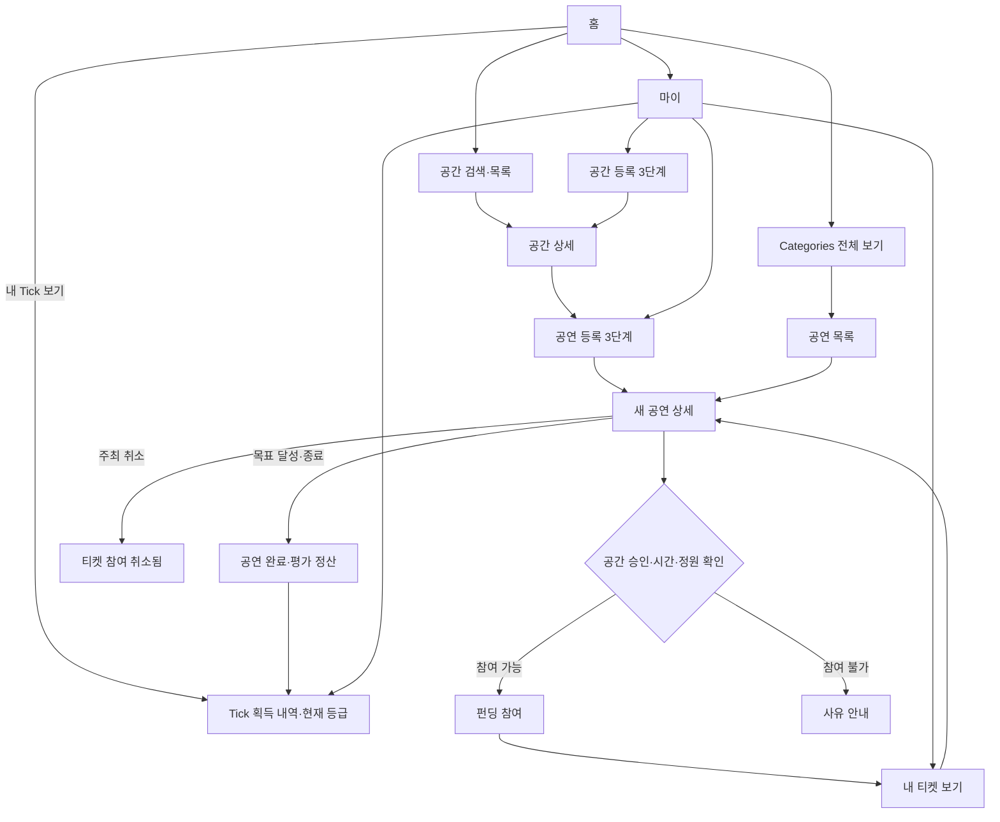

# CrocTick UX 흐름 점검

2026-11-12. 현재 Flutter 로컬 시연 앱의 실제 이동 경로를 기준으로 점검했다.

## 수정 후 흐름

## 확인한 문제와 수정

1. 홈 Categories의 전체 보기가 공간 목록으로 연결됐다. 공연 전체 목록으로 연결했다.
2. 공간·공연 등록을 마치면 이전 화면으로 돌아가 새 등록 결과를 찾기 어려웠다. 등록 결과를 반환하고 새 상세 화면을 바로 연다.
3. 등록 화면 상단·시스템 뒤로 가기가 입력한 여러 단계를 한 번에 닫았다. 2·3단계에서는 입력을 보존하고 이전 단계로 이동한다.
4. 공연 가격·정원 한도를 최종 저장 시에만 안내했다. 해당 입력란에 오류를 표시한다. 티켓 가격과 목표 관객 수로 달성할 수 없는 목표 금액도 입력란과 저장 로직에서 차단한다.
5. 참여할 수 없는 공연에도 버튼에는 참여 금액만 나타났다. 승인 대기·시작/종료·모집 마감·매진 사유를 표시하고, 저장 로직에도 동일한 조건을 적용한다.
6. 참여 완료 뒤 마이페이지를 찾아가야 티켓을 볼 수 있었다. 공연 상세에서 내 티켓 보기로 바로 이동한다.
7. 티켓 목록에 취소 상태가 없고, 상태 변경 후 화면 갱신도 되지 않았다. 저장소 변경을 구독하고 참여 취소 상태를 표시한다.

홈·공연의 원본 Figma 배치는 화면 회귀 테스트로 검사한다. 위 수정은 이동 연결과 등록·상세·티켓 상태에 적용한다.

## 검증 범위와 남은 항목

자동 검증은 단위·위젯·화면 회귀 검사와 Android·iPad 시뮬레이터의 탐색 및 등록·승인·참여·저장 흐름이다. 수정된 등록 시나리오는 저장 직후 새 상세 화면에 진입하고, 참여 후 티켓으로 바로 이동하는 경로를 확인한다.

갤러리의 실제 사진 선택, 실기기 하드웨어, 여러 사용자 간 서버 동기화는 별도 확인 대상이다. 공간 제공자 승인·완료 평가는 현재 기기 내 시연 조작이다. 기존 테스트 통과를 서비스 전체 검증 완료로 해석하면 안 된다.

알림 아이콘은 알림 목록을 연다. 이 기기에서 발생한 예약 승인·펀딩 참여와 목표 달성·공연 취소·정산을 표시한다. 알림을 열면 읽음 상태를 저장하고 해당 공연으로 이동한다. 기기 간 알림과 푸시 발송은 서버 연동 범위다.

홈의 Calm은 잔잔한 공연을, Band·Lo-fi·Jazz는 각 장르의 공연을 보여 준다. 공연 상단의 잔잔한·신나는·나만 아는 태그는 시연 공연의 제목과 출연자·장르를 기준으로 분류한다. 내 주변은 선택한 지역의 공연을 표시하고 필터 버튼에서는 장르·분위기와 지역을 함께 고를 수 있다. 왼쪽 위 Tick 버튼은 현재 점수와 등급을 연다. 등록과 설정은 마이에서 열 수 있다.
